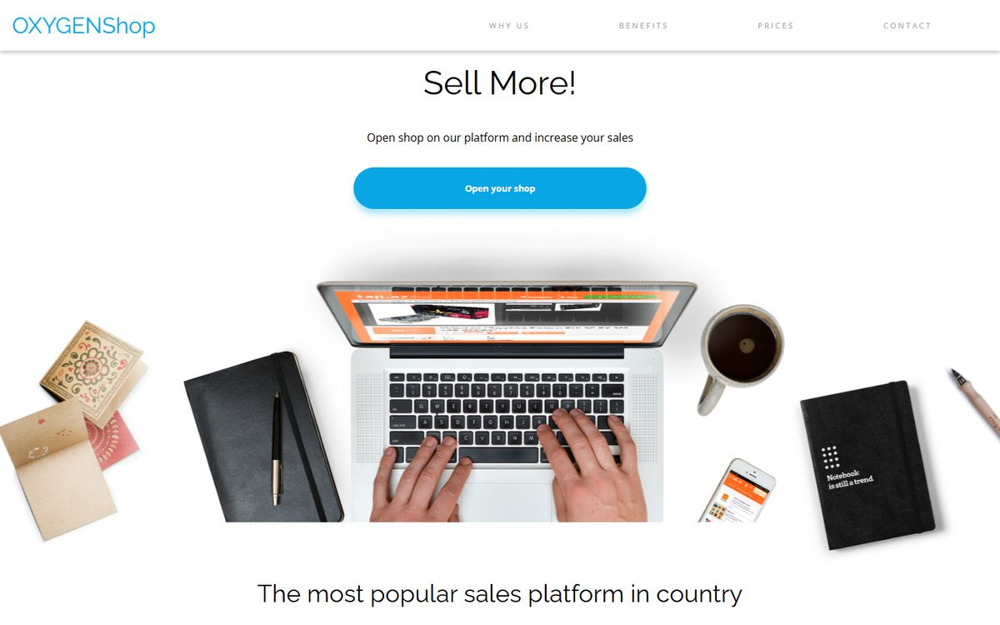
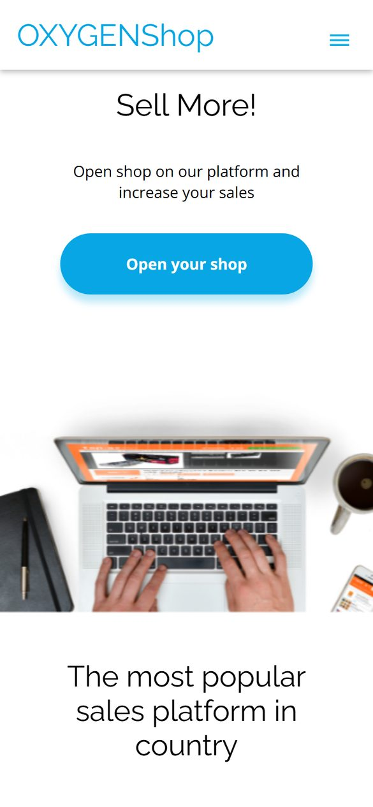

<div align="center">

# OXYGEN Shop

**Landing page de una plataforma de tiendas online, maquetada en HTML y SCSS y con interacción en JavaScript vanilla.**

Proyecto del bootcamp Full Stack de OXYGEN Academy · Módulos 1 y 2


[**Ver demo**](https://albertocalerocastillo.github.io/OxygenShop/)

</div>

<p align="center">
  
  &nbsp;
  
</p>

## Qué es

OXYGEN Shop es una landing de una página para una plataforma ficticia de comercio electrónico. En el módulo 1 se maquetó el diseño con HTML y SCSS (móvil y escritorio); en el módulo 2 se le añadió toda la interacción con JavaScript sin librerías, trabajando cada funcionalidad en una rama y fusionándola con pull requests.

## Funcionalidades

- **Menú hamburguesa** en móvil y navegación por anclas a las secciones (Why us, Benefits, Prices, Contact).
- **Barra de progreso de scroll** fija bajo la cabecera que crece según lo que llevas leído.
- **Botón de volver arriba** que aparece al pasar el 20 % de la página y sube con scroll suave.
- **Formulario de contacto validado**: nombre de 2 a 100 caracteres, email con expresión regular y casilla de consentimiento obligatoria; los campos erróneos se marcan en rojo y, si todo es correcto, se envía con `fetch` (POST) a la API de pruebas [reqres.in](https://reqres.in).
- **Popup de newsletter** con `<dialog>`: se abre a los 5 segundos o al bajar del 25 % de la página, se cierra con la X, clic fuera o `Esc`, y recuerda en `sessionStorage` que ya se cerró.
- **Selector de moneda** (USD, EUR, GBP) que recalcula los precios de los tres planes con tipos de cambio obtenidos de una API pública de divisas.
- **Slider propio** con flechas, puntos de navegación y avance automático cada 4 segundos.

## Stack

| Capa | Tecnología |
| --- | --- |
| Estructura | HTML5 |
| Estilos | SCSS con un parcial por sección, compilado a CSS |
| Interacción | JavaScript vanilla (DOM, eventos, `fetch`, `sessionStorage`) |
| APIs | reqres.in (envío de formularios) y currency-api de fawazahmed0 (divisas) |
| Control de versiones | Git y GitHub, con ramas y pull requests |
| Despliegue | GitHub Pages |

## Estructura

```
OxygenShop/
├── index.html
├── scripts/
│   ├── nav.js                    # Menú hamburguesa
│   ├── percentage-scroller.js    # Barra de progreso de scroll
│   ├── return-top.js             # Botón volver arriba
│   ├── validation-form.js        # Validación y envío del contacto
│   ├── popup.js                  # Newsletter en <dialog>
│   ├── currency-selector.js      # Cambio de moneda en precios
│   └── slider.js                 # Carrusel de imágenes
├── styles/
│   ├── styles.scss               # Punto de entrada (compila a styles.css)
│   └── _header.scss, _precios.scss, _popup.scss, ...
└── images/
```

## Puesta en marcha

No necesita instalación: es una web estática.

```bash
git clone https://github.com/albertocalerocastillo/OxygenShop.git
cd OxygenShop
# Abre index.html en el navegador o usa Live Server en VS Code
```

Para editar los estilos, compila el SCSS:

```bash
npx sass --watch styles/styles.scss styles/styles.css
```

## Qué aprendí

- A manipular el DOM y gestionar eventos (`click`, `scroll`, `submit`, `keydown`) sin depender de librerías.
- A validar formularios en cliente y enviar datos a una API con `fetch`, controlando la respuesta y los errores.
- A consumir una API externa y usar sus datos para actualizar la interfaz en tiempo real.
- A trabajar con Git como en un equipo: una rama por funcionalidad y pull requests para integrarla en `main`.

---

<div align="center">

Hecho por [Alberto Calero](https://github.com/albertocalerocastillo)

</div>
